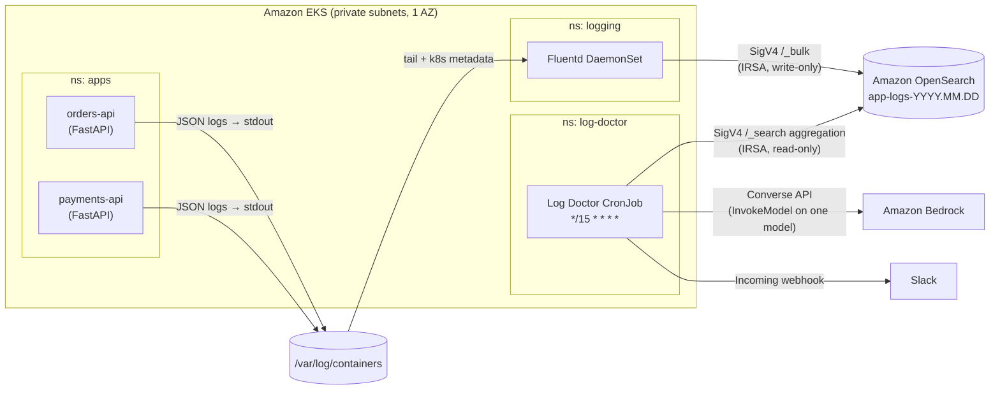

# 🩺 Log Doctor

**An LLM on-call buddy for Kubernetes: every 15 minutes it reads your ERROR logs from OpenSearch, asks an LLM on Amazon Bedrock (`openai.gpt-oss-20b-1:0` by default) what's going on, and posts a plain-English diagnosis to Slack.**

> If there are no errors, it stays quiet.

This repo is a complete, hands-on demo you can stand up in about 30 minutes and tear down with one command. Everything is Terraform + plain Kubernetes manifests + ~500 lines of Python.

```
:stethoscope: Log Doctor: 44 errors in 2 service(s), last 15 min

*orders-api* - 29 errors
• *What's happening:* Requests to fetch orders are failing because the service can't get a
  Postgres connection; 25 of 29 errors are the same `DatabaseConnectionError`.
• *Likely cause:* The database has run out of connection slots ("remaining connection slots are
  reserved"), most likely connection-pool exhaustion or a connection leak.
• *What to check:*
   • `SELECT count(*), state FROM pg_stat_activity GROUP BY state;` on orders-db
   • Pool size × replica count vs. Postgres `max_connections`
   • Recent deploys that changed pool settings or added long-running transactions

*payments-api* - 15 errors
• *What's happening:* Payment authorization calls to payment-gateway are timing out after 5s.
• *Likely cause:* payment-gateway is slow or unavailable; the 3 DB errors suggest it may share
  the same saturated database.
• *What to check:*
   • Latency/health of `payment-gateway.payments.svc` (`kubectl -n payments get pods`)
   • Whether the 5s client timeout is appropriate and retries have backoff
───────────────
model `openai.gpt-oss-20b-1:0` · 1840 in / 310 out tokens · index `app-logs-*` · Log Doctor 0.1.0
```
<sub>Illustrative output. The exact wording depends on the model you choose.</sub>

---

## Architecture



**Key design points**

- **The script does all the fetching.** The model never talks to OpenSearch. Log Doctor runs one aggregation query (top messages per service, with counts and 2 sample lines each), trims it, and sends only that summary to the model. That keeps the result predictable, auditable and cheap.
- **Token cost is bounded by config**, not by log volume: top 10 services × top 5 messages × 2 samples, stack traces trimmed to the last 12 lines, a hard 16k-character prompt budget, and `maxTokens` on the reply.
- **Secrets and PII are scrubbed** before anything leaves the cluster (AWS keys, bearer tokens, `password=`, emails, Slack webhooks). The prompt also tells the model to treat log text as untrusted data, and Slack control sequences like `<!channel>` are escaped.
- **Least privilege everywhere.** Each pod gets its own IAM role, scoped to exactly the API calls it needs (details below).

## Repo layout

```
infra/        Terraform: VPC, EKS, OpenSearch, ECR, IRSA roles
k8s/          Namespaces, ServiceAccounts, Slack Secret template
sample-app/   FastAPI service that logs structured JSON (+ Deployment/Service)
fluentd/      DaemonSet, RBAC and pipeline config → OpenSearch
log-doctor/   The Python job (opensearch-py + boto3 Converse) + CronJob
scripts/      Manifest rendering, error simulation, job log follower
Makefile      infra-up, build-push, deploy, simulate-errors, run-now, logs, infra-down …
```

---

## How authentication works (and why)

There are two workloads that talk to AWS, and neither has any static credentials.

| Workload | Kubernetes identity | IAM role can… |
|---|---|---|
| Fluentd | `logging/fluentd` SA | `es:ESHttpPost`, `es:ESHttpPut` on `/_bulk` and `/app-logs-*` |
| Log Doctor | `log-doctor/log-doctor` SA | `es:ESHttpGet`, `es:ESHttpPost` on `/app-logs-*/_search` only; `bedrock:InvokeModel` on **one** inference profile (and its underlying model, only via that profile) |

**OpenSearch: IAM-only access policy + IRSA.** The domain lives in the VPC, enforces HTTPS/TLS 1.2, has encryption at rest and node-to-node encryption, and only accepts SigV4-signed requests from the two roles above. Its resource-based access policy restricts each role to specific HTTP methods *and paths*.

I chose this over OpenSearch fine-grained access control (FGAC) because it's the **simplest secure option**. There's no master user, no internal role mappings, no extra step after `terraform apply`, and the whole policy is visible in [`infra/opensearch.tf`](infra/opensearch.tf). The trade-offs:

- Fluentd writes via `/_bulk`, where the index is named in the request body, so its role could write to *any* index. It still can't read, search or delete. If you need per-index write control, use FGAC.
- OpenSearch Dashboards needs SigV4 too, so this demo doesn't use it. Check ingestion with `make dry-run SKIP_LLM=1` instead (see step 6).

**Why IRSA and not EKS Pod Identity?** Both work for boto3. Fluentd's OpenSearch plugin, though, has first-class config for web-identity (IRSA) role assumption (`assume_role_web_identity_token_file`). Using IRSA for both workloads keeps one mechanism to explain. Each role's trust policy is pinned to an exact `system:serviceaccount:<namespace>:<name>`.

**Bedrock: one model in one region.** The default, `openai.gpt-oss-20b-1:0`, is called directly in `ap-south-1`, so the IAM policy allows only that model in that region. You can use a cross-region inference profile instead (IDs starting with `global.`, `apac.` and so on). A profile may route a request to another region, so the IAM policy then allows (1) the profile ARN in your region, and (2) the matching foundation model in any region, **only** when `bedrock:InferenceProfileArn` equals that profile. See [`infra/iam.tf`](infra/iam.tf).

---

## Prerequisites

- An AWS account on a **Paid plan** (the Free plan limits instance types), and an IAM identity that can create VPC/EKS/OpenSearch/ECR/IAM resources
- Permission to create an IAM OIDC provider (`iam:CreateOpenIDConnectProvider`), which IRSA needs. Check that no service control policy blocks it
- Locally: **AWS CLI v2** (a recent release; `bedrock-runtime converse` needs a 2024+ version), **Terraform ≥ 1.6**, **kubectl**, **Docker** (with buildx, for `linux/amd64` builds on Apple Silicon), **envsubst** (`brew install gettext` on macOS), `make`, `curl`
- A Slack workspace where you can add an app

> 💸 **This creates billable resources** (≈ US$6/day; see [Cost](#approximate-cost)). Run `make infra-down` when you're done.

---

## Step-by-step setup

### 1. Check the model on Amazon Bedrock

Log Doctor talks to Bedrock through the model-agnostic **Converse API**, so any Bedrock chat model works. The default is **`openai.gpt-oss-20b-1:0`** in `ap-south-1`.

1. **List the models you can call directly in your region:**

   ```bash
   aws bedrock list-foundation-models --region ap-south-1 --by-output-modality TEXT \
     --query "modelSummaries[?contains(inferenceTypesSupported,'ON_DEMAND')].modelId"
   ```

2. **Make a test call with your own admin identity.** Third-party models can create an AWS Marketplace subscription on first use, which Log Doctor's role isn't allowed to do:

   ```bash
   export MODEL_ID="openai.gpt-oss-20b-1:0"
   aws bedrock-runtime converse --region ap-south-1 --model-id "$MODEL_ID" \
     --messages '[{"role":"user","content":[{"text":"Reply with OK"}]}]' \
     --inference-config '{"maxTokens":800}'
   ```

   This model also returns reasoning blocks and counts them against `maxTokens`, so don't set the limit too low. Log Doctor keeps only the text.

<details>
<summary>Using a different model</summary>

Set `bedrock_model_id` in `infra/terraform.tfvars` and redeploy. IAM is generated for whichever ID you choose.

Some models, including Amazon Nova in `ap-south-1`, are only offered through cross-region inference profiles such as `global.amazon.nova-2-lite-v1:0`. List them with `aws bedrock list-inference-profiles --region ap-south-1 --query "inferenceProfileSummaries[].inferenceProfileId" --output text`. A profile can route requests to other regions, so a policy that limits your account to one region can block it.

Anthropic (Claude) models need two extra one-time steps: submit Anthropic's **use-case form** in the Bedrock console (Model catalog → pick the model; in an AWS Organization it can be done once in the management account), and invoke the model once with your own admin credentials. Check its quota too.

</details>

### 2. Create a Slack incoming webhook

1. Go to <https://api.slack.com/apps> → **Create New App** → **From scratch**, name it "Log Doctor", and pick your workspace.
2. **Incoming Webhooks** → toggle **On** → **Add New Webhook to Workspace** → choose a channel (e.g. `#alerts-demo`) → **Allow**.
3. Copy the URL (`https://hooks.slack.com/services/T…/B…/…`). **Treat it like a password**: anyone with it can post to your channel.

```bash
export SLACK_WEBHOOK_URL='https://hooks.slack.com/services/…'   # stays in your shell only
```

### 3. Configure and create the infrastructure

```bash
cp infra/terraform.tfvars.example infra/terraform.tfvars
# edit: bedrock_model_id, and cluster_endpoint_public_access_cidrs = ["<your-ip>/32"]
#   your IP: curl -s https://checkip.amazonaws.com
# If your account already has the OpenSearch service-linked role, set
#   create_opensearch_service_linked_role = false
#   (check: aws iam get-role --role-name AWSServiceRoleForAmazonOpenSearchService)

make infra-up      # terraform init + apply (~20-25 min, OpenSearch is the slow part), then updates kubeconfig
kubectl get nodes
```

### 4. Build and push the images

```bash
make build-push    # builds linux/amd64 images and pushes them to the two ECR repos (IMAGE_TAG=0.1.0 by default)
```

### 5. Deploy to Kubernetes

```bash
make slack-secret  # creates Secret log-doctor/slack-webhook from $SLACK_WEBHOOK_URL (nothing written to disk)
make deploy        # renders manifests from Terraform outputs into build/, applies them, waits for rollouts
make status
```

`make deploy` applies, in order: namespaces → ServiceAccounts (with IRSA role annotations) → Fluentd (RBAC, ConfigMap, DaemonSet) → the two sample services → the Log Doctor ConfigMap + CronJob.

### 6. Test end to end

```bash
# 1) Generate traffic + ~44 realistic errors (DB pool exhaustion, upstream timeout, NoneType bug)
make simulate-errors

# 2) Wait ~30s for Fluentd to flush, then check what Log Doctor *would* send to the model
#    (in-cluster, no Bedrock call, no Slack post). This also proves logs reach OpenSearch.
make dry-run SKIP_LLM=1

# 3) Call Bedrock but print the Slack message instead of posting it
make dry-run

# 4) The real thing: trigger the CronJob now and watch it post to Slack
make run-now

make logs          # logs from the most recent run
```

From here on, the CronJob runs every 15 minutes. Run `make simulate-errors` again whenever you want a new summary.

**Running Log Doctor from your laptop** (optional) only works where you can reach the VPC endpoint, e.g. through a VPN or bastion. The flags are the same:

```bash
cd log-doctor && pip install -r requirements.txt
OPENSEARCH_HOST=… AWS_REGION=ap-south-1 MODEL_ID=… python -m log_doctor.main --dry-run
```

---

## Configuration

Log Doctor reads everything from environment variables. The CronJob sets them in the `log-doctor-config` ConfigMap in [`log-doctor/k8s/cronjob.yaml`](log-doctor/k8s/cronjob.yaml).

| Variable | Default | Purpose |
|---|---|---|
| `OPENSEARCH_HOST` | (from Terraform) | VPC endpoint hostname |
| `AWS_REGION` | (from Terraform) | Region for SigV4 and Bedrock |
| `MODEL_ID` | (from Terraform) | Bedrock inference profile / model ID |
| `SLACK_WEBHOOK_URL` | (from Secret) | Incoming webhook; not needed with `--dry-run` |
| `LOOKBACK_MINUTES` | `15` | Query window (match the schedule) |
| `ERROR_LEVELS` | `ERROR,CRITICAL,FATAL` | Values of `level` that count as errors |
| `MAX_SERVICES` / `MAX_MESSAGES_PER_SERVICE` / `SAMPLES_PER_MESSAGE` | `10` / `5` / `2` | Aggregation sizes |
| `MAX_STACK_LINES` / `MAX_SAMPLE_CHARS` / `MAX_MESSAGE_CHARS` | `12` / `1200` / `300` | Per-sample truncation |
| `MAX_PROMPT_CHARS` | `16000` | Hard prompt budget (~4k tokens) |
| `MAX_OUTPUT_TOKENS` | `2000` | Reply cap |
| `BEDROCK_ADDITIONAL_FIELDS` | (unset) | Optional JSON passed as `additionalModelRequestFields` |
| `OPENSEARCH_INDEX_PATTERN` | `app-logs-*` | Indices to search (must match the IAM policy) |
| `LEVEL_FIELD` / `SERVICE_FIELD` / `MESSAGE_FIELD` / `TIMESTAMP_FIELD` | `level.keyword` / `service.keyword` / `message.keyword` / `@timestamp` | Point it at a different log schema |

CLI flags: `--dry-run` (print instead of post), `--skip-llm` (print the prompt, don't call Bedrock), `--minutes N`.

Behaviour worth knowing:

- **No errors → nothing posted**, exit 0.
- **If Bedrock fails**, Log Doctor still posts a raw digest (top messages and counts) so on-call isn't left blind. The Job exits 1 so the failure is visible.
- The CronJob uses `concurrencyPolicy: Forbid` and `backoffLimit: 0`, so a slow run never overlaps the next one and a retry never double-posts.
- Log Doctor's own logs are JSON with `service: log-doctor`. If it ever logs an ERROR, the next run reports on itself.

> 💡 **Logging tip from building this:** keep the log `message` *stable* ("Failed to fetch order from database") and put the variable parts (IDs, hosts, exception text) in separate fields. Aggregations group on `message.keyword`, and dynamic mappings only index the first 256 characters as a keyword.

---

## Approximate cost

Rough on-demand estimates based on **ap-southeast-2 (Sydney)** prices. `ap-south-1` will differ, so check the AWS pricing pages before you run this.

| Resource | Size | ≈ per hour | ≈ per day |
|---|---|---|---|
| EKS control plane | 1 cluster, standard support | $0.10 | $2.40 |
| EC2 worker | 1 × t3.medium | $0.045 | $1.08 |
| NAT gateway | 1 (+ $0.005/hr public IPv4) | $0.06 | $1.45 + data |
| OpenSearch | 1 × t3.small.search + 10 GB gp3 | $0.04 | ~$1.00 |
| EBS (node) | 20 GB gp3 | | $0.06 |
| ECR, CloudWatch, data transfer | tiny | | < $0.10 |
| **Bedrock** | only when errors exist | | see below |
| **Total infra** | | **≈ $0.25** | **≈ $6** |

**Bedrock:** a typical run sends about 1-4k input tokens and gets about 300-600 output tokens back. Even if every 15-minute window had errors (96 runs/day), that's roughly 0.4M input + 0.05M output tokens a day, which is cents to around $2/day depending on the model. See [Bedrock pricing](https://aws.amazon.com/bedrock/pricing/) for your model. Each Slack message footer shows the exact token counts.

> ⚠️ Keep `kubernetes_version` on a version in **standard** support. Clusters in extended support cost $0.60/hr instead of $0.10/hr.

---

## Teardown

```bash
make infra-down   # type "yes" when Terraform asks
```

This deletes the Kubernetes resources (CronJob, apps, Fluentd, namespaces), then runs `terraform destroy` for everything: OpenSearch domain, EKS cluster and node group, NAT gateway, VPC, IAM roles, and ECR repos (`force_delete` removes the images too). Expect about 15-20 minutes.

Then double-check that nothing is left:

```bash
aws opensearch list-domain-names --region ap-south-1
aws eks list-clusters --region ap-south-1
aws ec2 describe-nat-gateways --region ap-south-1 --filter Name=state,Values=available --query 'NatGateways[].NatGatewayId'
```

Optional cleanup: delete the Slack app (or just its webhook) at <https://api.slack.com/apps>. If Terraform created the OpenSearch service-linked role you can leave it; it costs nothing.

---

## Troubleshooting

| Symptom | Likely cause / fix |
|---|---|
| Fluentd: `MissingWebIdentityTokenFile` or `403` from OpenSearch | Pods started before the SA had its role annotation. Run `kubectl -n logging rollout restart ds/fluentd`. Check with `kubectl -n logging get sa fluentd -o yaml`. |
| Log Doctor: `AuthorizationException(403, …)` | Wrong role, or the index pattern doesn't start with `app-logs-`. The IAM policy only allows `/app-logs-*/_search`. |
| `AccessDeniedException` from Bedrock | `MODEL_ID` must equal Terraform's `bedrock_model_id` (both come from `terraform.tfvars`). Also make sure the use-case form and first invocation (step 1) are done. |
| `make dry-run SKIP_LLM=1` says "No errors in window" | Wait 30s after `simulate-errors` and check `make logs-fluentd`. Fluentd shows `log_os_400_reason` details if OpenSearch rejects documents. |
| Images fail with `exec format error` | They were built for arm64. `make build-push` passes `--platform linux/amd64`; rebuild with it. |
| `envsubst: command not found` | `brew install gettext` (macOS) or `apt install gettext-base`. |

---

## Ideas for extending it

- Thread follow-up runs into one Slack thread per incident (Slack bot token + `chat.postMessage`)
- Compare with the previous window ("new since last run" vs. "still happening")
- Add a link to the trace in your APM using the `trace_id` from the samples
- Swap the CronJob for an OpenSearch alerting monitor that triggers Log Doctor only on spikes

## License

[MIT](LICENSE)
